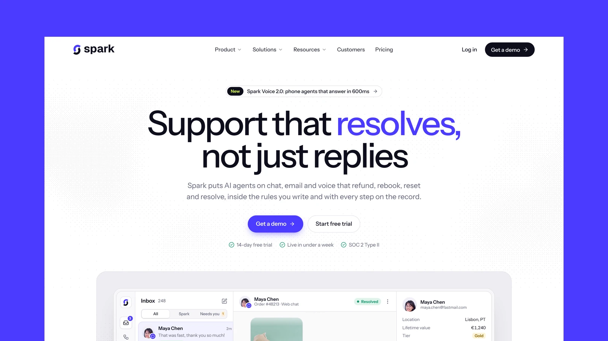

# Spark - Astro SaaS Theme

[](https://spark.xocoweb.workers.dev/)

[](https://astro.build/)
[](https://tailwindcss.com/)
[](https://www.typescriptlang.org/)
[](./LICENSE)

**Live preview:** https://spark.xocoweb.workers.dev/

Spark is a premium Astro theme for SaaS and AI products. Deep indigo and a lime spark on clean white and cool porcelain, soft rounded cards, a faint ordered dither, and a single sans-serif typeface give it a calm, expensive feel, and the homepage shows the product doing the work through live product UI built in HTML and CSS. The output is fully static, and every section reads its copy from a config file.

## Features

- A centred hero over a faint dither with an announcement pill and the product inbox on a light grey canvas
- An animated playbook canvas: pick a use case and watch its cards and status chips light up in sequence, with ARIA tabs and a pause button
- A bento grid of capabilities with small live visuals: tool calls, guardrail checks, a cycling language word, syncing sources, channel tiles, and a hand-off summary
- A pinned platform section that swaps product views as you scroll through Build, Launch, and Improve
- Product UI built in HTML and CSS (inbox, playbook editor, channels, insights, phone chat widget) with real customer photos, sharp at every size and reflowing down to phone width
- Count-up result figures, an orbiting integrations ring of real connector icons, and a scrolling customer logo strip
- A feature story card with a portrait above quote cards
- A floating pill header that hides on scroll down, with rounded dropdowns carrying icons and a featured card, and a full-screen mobile menu
- A pricing page with a billing toggle, a raised featured plan, and a comparison table with a sticky plan header and a one-plan view on phones
- About, careers, and contact pages, plus an industry page template with an intent table and an interactive peak-week chart
- A blog with a lead post, topic archives, a table of contents with scroll-spy, a reading-progress bar, co-authored bylines, a call-to-action panel placed from frontmatter, and a share sheet
- Client-side blog search as a keyboard palette (`/` or `⌘K`) and a results page
- Photo blog covers with credits, plus a script that draws icon covers in the theme's style
- Canonical URLs, sitemap, RSS, `robots.txt`, Open Graph, Twitter/X cards, and JSON-LD
- Self-hosted Instrument Sans, Lucide icons, and colour, radius, and type tokens in one stylesheet
- Static output with no framework islands; every animation pauses or settles under `prefers-reduced-motion`
- Skip link, landmarks, labelled controls, visible focus states, and keyboard support for every menu, tab set, and dialog

## Tech Stack

- Astro 7 with MDX
- Tailwind CSS 4 via the Vite plugin
- Vite 8, TypeScript, Astro content collections
- `@astrojs/sitemap`, `@astrojs/rss`, Sharp
- cobe for the WebGL globe on the about page
- Self-hosted Instrument Sans, Lucide and Bootstrap Icons, Simple Icons for integrations, each with its license notice

## Requirements

- Node.js `22.12.0` or newer (`22.18.0` or newer to render icon covers)
- npm

## Getting Started

```bash
npm install
npm run dev
```

Build for production:

```bash
npm run build
```

Preview the production build locally:

```bash
npm run preview
```

Render covers for new posts (`--force` redraws every cover):

```bash
npm run covers
```

Before shipping a change, run type checking, the production build, and the formatter check together:

```bash
npm run release:check
```

## Customization

See [CUSTOMIZATION.md](./CUSTOMIZATION.md) for site settings, the navigation and dropdowns, homepage sections, the playbook canvas, the product UI and its demo data, the pricing, industry, contact, about and careers pages, the blog, blog covers, sharing, search, feeds, the newsletter form, and the theme's design tokens.

Set `siteConfig.siteUrl` in [src/config/site.ts](./src/config/site.ts) before building — canonical URLs, share images, the sitemap, and the feed are all derived from it. The build is static, so any host that serves a directory works: `wrangler.jsonc` is included for Cloudflare Workers, and Netlify, Vercel, GitHub Pages, and object storage behind a CDN need no configuration beyond `npm run build`.

## Content

Posts live in [src/content/blog](./src/content/blog). Each post is a folder with an `index.md` (or `index.mdx`) and a cover image beside it, validated by the schema in [src/content.config.ts](./src/content.config.ts). Authors and topics are defined in [src/config/blog.ts](./src/config/blog.ts).

The bundled demo content is fictional — the company, the authors, the customers, the quotes, and the figures are invented, so **replace them before launch.** The customer and leadership portraits are stock placeholders of people with no connection to the names and quotes beside them, and the customer logos are fictional marks.

The product UI shows a fictional app with demo data in [src/config/demo.ts](./src/config/demo.ts); replace its data or swap it for screenshots of your own product.

The integration icons come from [Simple Icons](https://simpleicons.org/) under CC0. The brands are trademarks of their owners, appear as placeholder content only, and imply no endorsement or partnership.

Demo photography comes from [Unsplash](https://unsplash.com/) and [Pexels](https://www.pexels.com/) under their licenses, credited in [src/config/home.ts](./src/config/home.ts), [src/config/demo.ts](./src/config/demo.ts), [src/config/industries.ts](./src/config/industries.ts), [src/config/about.ts](./src/config/about.ts), [src/config/careers.ts](./src/config/careers.ts), and [src/config/blog.ts](./src/config/blog.ts). Blog cover photos come from Pexels and are credited under each post.

## Support

See [SUPPORT.md](./SUPPORT.md) for what a license includes, and [CHANGELOG.md](./CHANGELOG.md) for release history.

## License

Commercial license. See [LICENSE](./LICENSE) for complete terms.

## Credits

- [Instrument Sans](https://github.com/Instrument) by Instrument, under the SIL Open Font License
- [Lucide](https://lucide.dev/), under the ISC License
- [Bootstrap Icons](https://icons.getbootstrap.com/), under the MIT License
- [Simple Icons](https://simpleicons.org/), under CC0
- [cobe](https://github.com/shuding/cobe) by Shu Ding, under the MIT License
- Photography from Unsplash and Pexels, credited per image
